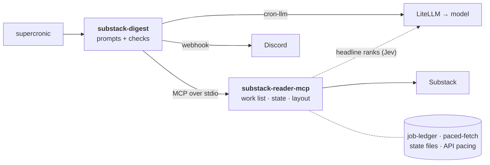

<div align="center">

# Substack Digest

**A daily digest of your Substack subscriptions and chats, read in full by a model and posted to Discord.**


[How it fits together](#how-it-fits-together) · [What the model is asked](#what-the-model-is-asked) · [How a run goes](#how-a-run-goes) · [Running it](#running-it) · [Configuration](#configuration) · [Development](#development)

</div>

A daily digest of every new post in your Substack subscriptions, plus chat activity, posted to a Discord channel. Every post is read in full by a model, which reports what it argues and how much is lost by reading only that; a final call picks the few worth reading in full.

It's a plain scheduled job, not an agent:

- [substack-reader-mcp](https://github.com/wkbaran/substack-reader-mcp) runs as a child process. Its digest tools fetch the posts, number them, lay out the message and keep the state (what was already reported, publications to re-check).
- [cron-llm](https://github.com/wkbaran/cron-llm) calls any OpenAI-compatible gateway with a JSON schema per question, and posts to the Discord webhook.
- The model answers three kinds of narrow questions: one per post (type, gist, depth 1–5, why), one per chat (topics, anything addressed to you), and one for the picks. The code checks every answer: refs must exist, at most two picks per publication, every post gets an entry.

## How it fits together



The job holds only the prompts and the checks on each answer. [cron-llm](https://github.com/wkbaran/cron-llm) gives it the model calls, the MCP client and the Discord post. The MCP server owns everything with consequences: the API, the state and the message layout, on [job-ledger](https://github.com/wkbaran/job-ledger) for state and [paced-fetch](https://github.com/wkbaran/paced-fetch) for API pacing. The model never touches state or the API directly. The other jobs ([medium-digest](https://github.com/wkbaran/medium-digest), [spotify-discovery](https://github.com/wkbaran/spotify-discovery)) have the same shape with a different server.

## What the model is asked

The model never sees the whole day at once. It answers three kinds of narrow question, each with a JSON schema, and every answer is checked by code. The questions are written to get past the usual failure of digest summaries: a sentence about what a post is *about*, which tells you nothing about whether to read it.

**One question per post**, with the post's text (paged, never just the title). The model is told the reader subscribes to these publications and isn't their author, and to judge only from the text given.

| Field | What it means |
|---|---|
| `type` | essay, reporting, analysis, tutorial, link-roundup, announcement, podcast-notes, fiction or other. A paid podcast with only show notes is podcast-notes |
| `gist` | **The post's actual argument or findings, not its topic**, in 1–2 sentences. It leads with the claim ("Rate limits cut tail latency more than retries do, because…"), never "This post discusses…" or "The author argues…". For a roundup, only its main item. Its length is the server's limit (`SUBSTACK_DIGEST_GIST_MAX`), stated in the prompt as characters and approximate words, since models count words better |
| `depth` | 1–5: **how much you lose by reading only the gist.** 5 is dense original thinking or evidence that doesn't compress; 1 means the gist covers it. This is what a pick is built on: a good post with depth 1 doesn't need reading |
| `why` | One sentence justifying the depth, naming what's distinctive |

The reader's `interests.md` is shown as context, with the instruction to describe the post as it is: interests shouldn't colour the gist.

**One question per chat** with new activity: `topics` (the main threads, not who said what), `for_user` (any question or mention aimed at the reader, else "none") and `posts_discussed`. The model summarizes; it's told never to write replies.

**One question for the picks**, over all the verdicts (ref, depth, type, whether only a preview was readable, the classifier's rank, whether a chat discussed it, gist and why):

- start from depth 4–5; rank up posts that match the interests, rank high with the classifier, or came up in a chat;
- rank down link-roundups, announcements and podcast-notes whatever their depth, and preview-only posts ("a gist of a teaser isn't a reason to read the whole post");
- at most 2 per publication, usually 3–7, and **none rather than padding** on a weak day;
- each pick gets one sentence on why it's worth reading in full, naming what's distinctive rather than repeating the gist.

The code then checks the answers: every ref must exist, the per-publication cap holds, and every post gets an entry. An answer that doesn't fit its schema costs that one post its gist, not the run.

## How a run goes

1. `digest_begin` returns the work list as data: posts (with the classifier's rank, if it's on), chats, and your `interests.md`.
2. Each post is read with `read_post` (paged up to `MAX_POST_CHARS`) and judged. Posts the classifier set aside aren't read.
3. Each chat with activity is read with `get_chat_activity` and summarized.
4. One call chooses the picks from the verdicts. If its answer is unusable, the picks fall back to depth 4–5.
5. `digest_finish` saves state and returns the message, which goes to Discord. `[SILENT]` (nothing new) posts nothing.

An answer that doesn't fit its schema costs that post its gist, not the run. A gateway error or a server crash ends the run with a failure notice, and the next run covers the same period, since state is saved only by `digest_finish`.

## Running it

```sh
npm install
npm run build
cp docker/.env.example .env                    # fill in; the host directories are only for the container
node --env-file=.env dist/main.js --dry-run    # prints the message; digest_finish saves nothing
```

Sign in to Substack once on a machine with a browser (`npx substack-reader-mcp login`), and point `SUBSTACK_READER_HOME` at the directory holding `auth.json`.

### In a container

`docker/` has a Dockerfile, a crontab for [supercronic](https://github.com/aptible/supercronic) (06:00 in the container's `TZ`) and a compose file. Copy `docker/.env.example` to `docker/.env`, set the host directories and the rest, then:

```sh
docker compose -f docker/compose.yaml up -d --build
docker exec substack-digest node /app/dist/main.js --dry-run   # try it now
docker logs substack-digest                                     # one line per step and per model call
```

The container runs as uid 1000; the state and auth directories should belong to it.

## Configuration

| Variable | |
|---|---|
| `LLM_BASE_URL`, `LLM_API_KEY`, `LLM_MODEL`, `LLM_REASONING_EFFORT` | The gateway and model (see cron-llm). Requests are tagged `job:substack-digest`, `run:<run id>` and `step:post` / `step:chat` / `step:picks` for the gateway's logs |
| `DISCORD_WEBHOOK_URL` | Where the digest goes. Without it, the message is printed |
| `DISCORD_FAILURE_WEBHOOK_URL` | Where failure notices go; defaults to the digest webhook |
| `SUBSTACK_*`, `TZ` | Passed to substack-reader-mcp, and nothing else from the job's environment is. `SUBSTACK_DIGEST_DIR` defaults to `/data` and `SUBSTACK_READER_HOME` to `/auth`. See its README for the classifier and the rest |
| `SUBSTACK_REAUTH_HINT` | What to do when the session expires; it's sent in place of the digest |
| `SUBSTACK_DIGEST_GIST_MAX`, `_WHY_MAX`, `_TOPICS_MAX`, `_FOR_USER_MAX` | The server's length limits. `digest_begin` returns them, and the job writes the same numbers into its prompts and schemas, so the model is asked for what the server keeps. Set them here, not in the prompts |
| `MAX_PICKS`, `PICKS_PER_PUBLICATION` | Most picks in all and from one publication (default 10, 2), also stated in the picks prompt |
| `MAX_POST_CHARS` | How much of one post the model reads (default 60000) |
| `JOB_DRY_RUN=1` | Same as `--dry-run` |

## Development

```sh
npm test
```

Node 26 or later. MIT licensed.
